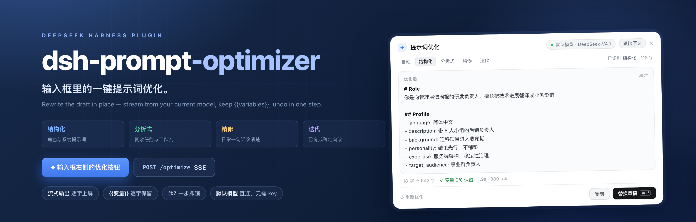
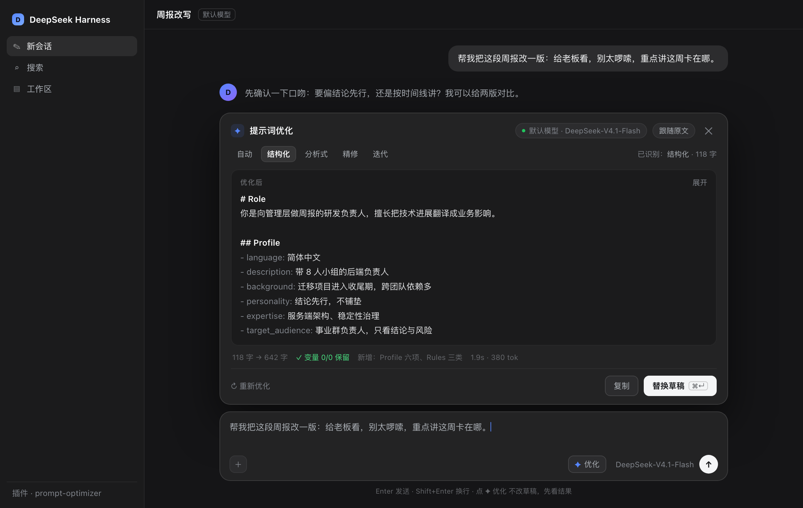
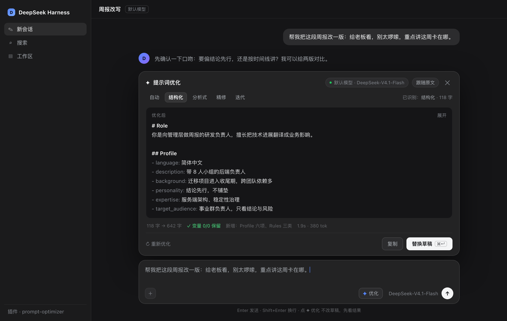
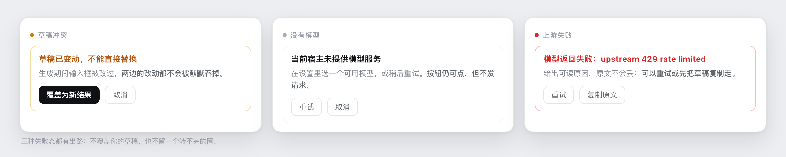

<sub>UI mock-up: the model name, character counts and timings vary by environment.</sub>

# @infcel/dsh-prompt-optimizer

[简体中文](README.md) · **English**

    

**Prompt optimization.** Adds a **✦ optimize** button to the DeepSeek Harness composer: it rewrites the sentence you just typed into a prompt with clear structure and explicit constraints, puts it back in the composer, and one undo restores the original.

npm [`@infcel/dsh-prompt-optimizer`](https://www.npmjs.com/package/@infcel/dsh-prompt-optimizer) · repo [infcel/dsh-prompt-optimizer](https://github.com/infcel/dsh-prompt-optimizer)

The product idea is inspired by [linshenkx/prompt-optimizer](https://github.com/linshenkx/prompt-optimizer): put optimization inside the composer instead of a separate workbench. Templates and code are original to this repo: **it calls the session's default model, so you don't configure a second API key**.

## Install in 30 seconds

### Desktop

Click **Add plugin** in the plugin manager and paste the package name, or have the agent call the tool:

```
plugin_manager(action: "install_bundle", target: "@infcel/dsh-prompt-optimizer")
```

### web / CLI profile

The Desktop profile is owned by Electron (`dsh plugin --profile desktop add` errors with "managed exclusively"), so this line is for a web or self-hosted profile:

```
dsh plugin --profile web add @infcel/dsh-prompt-optimizer
```

### Offline tarball or local source

| Form | target |
| --- | --- |
| npm package name | `@infcel/dsh-prompt-optimizer` |
| offline tgz (from `npm run release`) | `/abs/path/infcel-dsh-prompt-optimizer-1.0.5.tgz` |
| source directory under development | `<absolute path to this repo>` |

### Confirm it worked

Restart Harness (bundle/patch are a boot snapshot) → a **✦ optimize** button shows up right of the composer → type a draft and click it.

Two places tell you it worked: the button beside the composer, and a "Prompt Optimizer" entry in the plugin manager. Requires DSH ≥ 0.2.0-rc.1 and Node 22.19+ or 24+ (see `engines` in `package.json`). Release process: [`RELEASING.md`](RELEASING.md).

It looks roughly like this once installed (the composer at the bottom holds your draft):



## What it does and doesn't do

| Does | Doesn't |
| --- | --- |
| Rewrites the wording and structure of the draft itself | Never executes the prompt — it won't do the task for you |
| Uses the session's default model, no extra key | Produces no media, renders nothing |
| Selection → rewrite only that span; no selection → whole draft | Keeps no history, favorites or template library |
| Keeps `{{variables}}` verbatim and checks them | Never fills variables in |
| Blocks the replace if the draft changed meanwhile | Never silently overwrites what you just typed |

## Modes

The panel switches modes at the top: **auto** picks one by text heuristics, the other four are manual.

| Mode | Good for | What comes out |
| --- | --- | --- |
| Auto | You don't want to choose | Delegated to the heuristics below |
| Structured | A reusable role prompt you'll keep | `# 角色` + `## 适用场景 / ## 能力范围 / ## 工作约束 / ## 执行流程 / ## 开场方式`; capabilities split into "good at / not responsible for", constraints into "must / never / output" |
| Analytical | Complex task, missing context or output format | `# 任务目标` + `## 前提与输入 / ## 分析维度 / ## 判定标准 / ## 执行顺序 / ## 输出格式 / ## 交付前自检`, with checkable acceptance criteria |
| Polish | One vague sentence you want to send as-is | Flattened into a single paragraph: adds audience, scope, constraints and output form, no headings or lists (at most 3× the original length) |
| Iterate | You have a finished draft and want one change | Keeps the existing structure; folds "this is what to change" into the text |

Auto-mode rules (`lib/heuristic.js`, the same file on client and host):

| Condition | Result |
| --- | --- |
| 400+ chars and carries a skeleton (`{{variable}}`, `#` heading, `Role:`, or "You are …") | Structured |
| 600+ chars and mentions steps / workflow / output format | Analytical |
| Under 400 chars and no `#` heading | Polish |
| Everything else | Analytical |

Iterate mode adds one more input for your instruction, e.g. "shorter, keep the variables, add a don't-do list". It is a rewrite instruction, not a follow-up to the model — the plugin won't execute it.

## Interaction details

**Selection.** With a selection, only that span goes to the model and only that span is replaced; without one, the whole draft.

**`@` references.** When the draft contains `@` reference chips, selection coordinates and string indices no longer share an origin, so it **always optimizes the whole draft** and shows a "contains @ references — optimizes the whole draft" banner. Better to rewrite too much than to write at the wrong offset.

**Replace and undo.** It goes through `insertText`, one discrete undoable edit: ⌘Z (Ctrl+Z on Windows) restores in one step, not character by character. ⌘↵ in the result area replaces directly. A 4-second confirmation bar follows a successful replace.

**Draft conflict.** If you edit the composer while a generation is running, the replace is blocked with "draft changed" and you must explicitly choose **overwrite with new result** — neither side's edits are swallowed silently.

**Variables.** `{{names}}` are never added, removed, renamed or translated. After generation the plugin checks that every original variable is still there and names the missing ones in the meta row.

**Oversized drafts.** The cap is 20,000 characters (`/meta` → `limits.maxChars`). It's rejected as soon as the panel opens, no round trip needed; the host keeps a 413 as a backstop.

**Language.** UI copy follows the Harness language (Chinese / English); switching it re-renders the button and panel immediately, no reload. Output language is a separate setting: follow the source / 简体中文 / English.

## Settings and state

| Item | Value |
| --- | --- |
| Preferences | `localStorage` key `dsh.prompt-optimizer.prefs`, content `{mode, language}`; invalid values fall back to `auto` |
| Model | Follows the Harness default; fallback chain below |
| History | Nothing is persisted or logged; closing the panel discards it |

Model selection order: current default selection → first model of that provider → first model of the first provider → otherwise 503 and the panel shows "no model service in this host".

## Technical notes

| Item | Value |
| --- | --- |
| Entry button | slot `conversation.input.right`, id `prompt-optimizer`, order 0 |
| Floating panel | slot `conversation.input.overlay`, id `prompt-optimizer-panel`, order 20 |
| Model calls | host `llm.stream()` + `agentDefaultModel.currentSelection()` |
| Routes | `GET /api/dsh-prompt-optimizer/meta`, `POST …/classify`, `POST …/optimize` (SSE) |
| Client parsing | SSE framing is inlined in `client.js`; unit tests feed it one byte at a time |

**Theming.** The panel uses `bg-layer-1`, the result area `bg-base`: in dark mode they differ by one step (#232324 / #151517); in light mode both are pure white and only a 1px border separates them. That's the host's actual token behaviour — the plugin adds no colors of its own.



**Footprint.** Two registrations, one per composer sub-slot. It doesn't replace host nodes, never appends to `document.body`, styles only with `--dsw-alias-*` / `--dsw-*` tokens, injects its `<style data-plugin>` through `ctx.effect` so it goes away on unload, registers no window-level keyboard listeners, and talks to nothing but same-origin `/api/dsh-prompt-optimizer/*`.

## Failure and degradation



| Situation | What the user sees |
| --- | --- |
| Host has no model service | Neutral info card ("no model service" + retry/cancel); the button still responds but sends nothing |
| Upstream 429 / rate limit | Red bar with a readable reason + **retry** / **copy original** |
| Draft over 20,000 chars | Rejected as the panel opens, with a hint to split it; host 413 as backstop |
| Draft changed during generation | Yellow bar "draft changed" with **overwrite** and **cancel** |
| Panel closed mid-stream | Request aborted, no uncaught error in the console |
| Not signed in / expired token | Route returns 401 and the panel shows the reason in its error state |

## Upgrade and rollback

**Upgrade.** After changing `client.js`, **hard refresh** (⇧⌘R) — a normal refresh may hit the boot graph cache. Host-side changes (`index.js` / `lib/*`) need a restart.

**Host upgrades.** If `conversation.input.right` / `conversation.input.overlay` are renamed or removed, registration fails, no button appears (no half-rendered UI), and the console shows the slot error the host raised. Point `SLOT_BUTTON` / `SLOT_PANEL` in `client.js` at the new names.

**Rollback.**

1. Disable: `plugin_manager(action: "set_plugin", target: "include:prompt-optimizer", enabled: false)`. Takes effect immediately on a live profile, no restart.
2. Uninstall: `plugin_manager(action: "remove_bundle", target: "@infcel/dsh-prompt-optimizer")`, then drop the entry from the profile's `package.json` and `dsh.profile.bundles`.
3. Backups taken before install: the profile's `package.json.bak-*` and `cordis.patch.yml.bak-*`; restore both and restart to get back to the pre-install state.

`dsh.prompt-optimizer.prefs` in `localStorage` is not cleaned up automatically; delete it by hand (it only affects default modes).

## FAQ

**The button doesn't show up.** Confirm you restarted (not refreshed), then check that `include:prompt-optimizer` in `list_plugins` is `enabled=true` with `fiberPhase=active`.

**It spins and produces nothing.** The upstream is streaming but the first token can be slow; the panel header shows the model name — make sure it isn't "model not ready".

**The replace was blocked.** The draft changed during generation. Either **overwrite with new result** or **cancel** and run again.

**Why does `curl` get 401 on these routes?** They sit behind the host's same-origin guard and only accept requests from a GUI session, which the command line doesn't have.

## Development and tests

```
node --test test/*.test.mjs                                    # 47 passing
node plugin-dev/scripts/plugin-check.mjs dsh-prompt-optimizer  # 1 PASS / 0 WARN / 0 FAIL
node --check index.js lib/*.js client.js
```

Run `plugin-check` from the repo root (`plugins/`).

`client.js` is a bundle (`window.__ModuleLoader__.load({id, factory})`) and **cannot** `require` the plugin's own `lib/*.js` — the client module loader resolves purely by module id. That's why SSE framing is inlined in `client.js`, and the tests grab the factory through a fake loader.

### Verification status

Verified on a real host (DSH Desktop, light and dark themes):

- token-by-token streaming, stoppable mid-flight;
- a selection rewrites only that span, the rest is untouched;
- `@` references in the draft switch it to whole-draft mode, with a banner;
- editing the draft during generation is blocked and can be explicitly overridden;
- one ⌘Z restores the original; ⌘↵ replaces directly;
- with no model in the host it enters the "no model service" state and sends nothing.

**Not verified yet**: drafts over 20,000 characters (the guard has unit tests, the real hint was never triggered), an actual upstream 429 (the error state was verified by injection), and a post-restart check of `fiberPhase` plus both slot occupants.

The dated, per-version log lives in [`docs/verification.md`](https://github.com/infcel/dsh-prompt-optimizer/blob/main/docs/verification.md).

## License and credits

Released under **MIT**: the full [`LICENSE`](LICENSE) is in the repo and `package.json` carries the same value.

The four mode templates — skeletons and wording — are original to this project; no third-party template text was copied. The host routes, the client panel and its streaming parser are likewise independent work.

The product idea is inspired by [linshenkx/prompt-optimizer](https://github.com/linshenkx/prompt-optimizer), which showed that "one-click optimize next to the composer" is worth building; this plugin contains none of its code or prompt text.

1.0.x shipped under AGPL-3.0 while it still echoed the upstream template expression; 1.1.0 rewrites the templates from scratch and moves to MIT.
