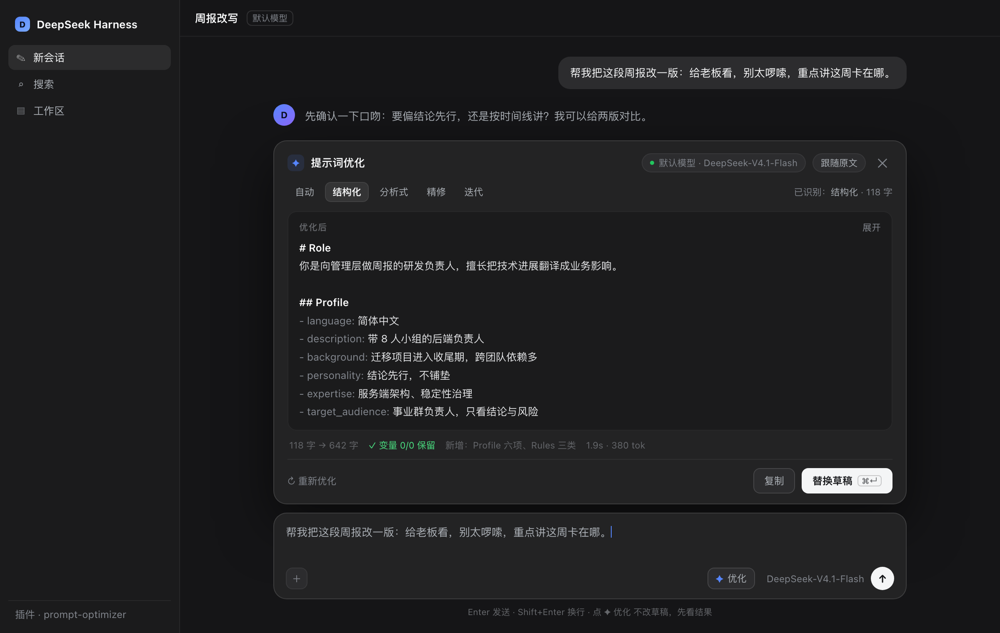
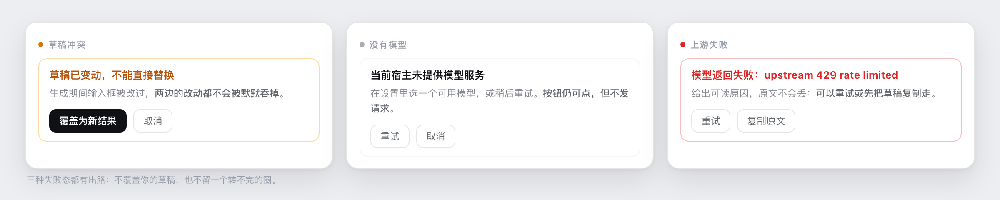

# 提示词优化 · @infcel/dsh-prompt-optimizer

给 DeepSeek Harness 的输入框加一个 **✦ 优化**：把随手写下的一句话，改写成结构清楚、约束明确的提示词，替换回输入框，一次撤销就能还原。

npm [`@infcel/dsh-prompt-optimizer`](https://www.npmjs.com/package/@infcel/dsh-prompt-optimizer) · 仓库 [infcel/dsh-prompt-optimizer](https://github.com/infcel/dsh-prompt-optimizer)


<sub>界面示意：实际模型名、字数与耗时随环境变化。</sub>

模板思路移植自 [linshenkx/prompt-optimizer](https://github.com/linshenkx/prompt-optimizer)，调用链改成了 DSH 原生：**用当前会话的默认模型，不需要再配一套 API Key**。

---

## 30 秒上手

```
plugin_manager(action: "install_bundle", target: "@infcel/dsh-prompt-optimizer")
```

重启 Harness（bundle/patch 是启动快照）→ 输入框右侧出现 **✦ 优化** → 写一句草稿，点它。

装没装好，看两处：输入框右侧有按钮，插件管理页里有「提示词优化」的条目。

要求 DSH ≥ 0.2.0-rc.1，Node 22.19+ 或 24+（见 `package.json` 的 `engines`）。

其他安装方式：

| 方式 | target |
| --- | --- |
| npm 包名 | `@infcel/dsh-prompt-optimizer` |
| 离线 tgz（`npm run release` 产出） | `/绝对路径/infcel-dsh-prompt-optimizer-1.0.2.tgz` |
| 开发中的源码目录 | `<本仓库目录的绝对路径>` |

发布流程见 [`RELEASING.md`](RELEASING.md)。

## 它做什么，不做什么

| 做 | 不做 |
| --- | --- |
| 改写草稿本身的措辞与结构 | 不执行提示词，不会顺手把活干完 |
| 用当前会话的默认模型，不额外配 key | 不产出任何媒体文件、不渲染 |
| 选中一段只改一段，没选区就改整段 | 不保存历史、不做收藏与模板库 |
| `{{变量}}` 逐字保留并校验 | 不给变量填值 |
| 生成期间草稿被改动会拦下 | 不会悄悄覆盖你新写的内容 |

## 模式

面板顶部是模式切换：**自动**按文本启发式选一种，另外四种手动指定。

| 模式 | 适合 | 产出长什么样 |
| --- | --- | --- |
| 自动 | 懒得选 | 交给启发式，规则见下 |
| 结构化 | 要一个能长期复用的角色提示词 | `# Role` + `## Profile / ## Skills / ## Rules / ## Workflows / ## Initialization`，Skills 与 Rules 各分三类、每类 4 条 |
| 分析式 | 任务复杂、缺背景与输出格式 | `Role / Background / Attention / Profile / Skills / Goals / Constrains / Workflow / OutputFormat / Suggestions / Initialization` 逐节展开，多数小节 5 条 |
| 精修 | 一句话说得含糊，想要能直接发出 | 压成一段自然语言，补全对象/范围/约束/输出形式，不加标题与列表（长度不超过原文 3 倍） |
| 迭代 | 已有成稿，只想改一处 | 保留原有结构，把「这次怎么改」融进原文 |

自动模式的判定（`lib/heuristic.js`，客户端与 Host 同一份）：

| 条件 | 结果 |
| --- | --- |
| 400 字以上，且带骨架（`{{变量}}`、`#` 标题、`Role:`、或「你是…」） | 结构化 |
| 600 字以上，且出现「步骤 / 流程 / 工作流 / 输出格式」这类词 | 分析式 |
| 400 字以内，且没有 `#` 标题 | 精修 |
| 其余 | 分析式 |

「迭代」模式会多出一个输入框，写你这次的修改意图，例如「再短一点，保留变量，加一个「不做」清单」。它是改写指令，不是给模型的追问——插件不会替你执行。

## 交互细节



**选区。** 有选区就只把选中那截送给模型，回填也只替换那一截；没有选区就整段。

**`@` 引用。** 草稿里带 `@` 引用 chip 时，选区坐标与字符串下标不同源，此时**一律按整段优化**，面板里显示一条「含 @ 引用，按整段优化」的横幅。宁可多改，不会改错位。

**回填与撤销。** 走 `insertText`，是一次独立的可撤销编辑：⌘Z（Windows：Ctrl+Z）一步还原，不是逐字撤回。结果区也可以按 ⌘↵ 直接替换。替换成功后有 4 秒确认条。

**草稿冲突。** 生成期间你改了输入框，替换会被拦下并提示「草稿已变动」，需要显式点**覆盖为新结果**——两边的改动都不会被默默吞掉。

**变量。** `{{变量名}}` 不新增、不删除、不改名、不翻译。生成结束后统计原文变量是否都在，缺了会在元信息行点名。

**超长草稿。** 上限 2 万字（`/meta` 的 `limits.maxChars`）。打开面板时就地拦下，不用等一轮请求；Host 侧另有 413 兜底。

**语言。** 界面文案跟随 Harness 语言（中文 / English），切换后按钮与面板立即换文案，不需要重载。输出语言另有一档：跟随原文 / 简体中文 / English。

## 设置与状态

| 项目 | 值 |
| --- | --- |
| 偏好存储 | `localStorage` 键 `dsh.prompt-optimizer.prefs`，内容 `{mode, language}`，非法值回落 `auto` |
| 模型 | 跟随 Harness 的默认模型；回落链见下 |
| 历史 | 不落盘、不留日志，关掉面板就没了 |

模型选择顺序：当前默认选择 → 该 provider 的首个模型 → 首个 provider 的首个模型 → 都没有则 503，面板显示「当前宿主未提供模型服务」。

## 技术档案

| 项目 | 值 |
| --- | --- |
| 入口按钮 | slot `conversation.input.right`，id `prompt-optimizer`，order 0 |
| 浮层面板 | slot `conversation.input.overlay`，id `prompt-optimizer-panel`，order 20 |
| 模型调用 | Host `llm.stream()` + `agentDefaultModel.currentSelection()` |
| 路由 | `GET /api/dsh-prompt-optimizer/meta`、`POST …/classify`、`POST …/optimize`（SSE） |
| 客户端解析 | SSE 帧解析内联在 `client.js`，单测按 1 字节切分验证 |

**影响范围。** 只往两个 composer 子槽各注册一项；不替换宿主节点，不 append 到 `document.body`；样式只用 `--dsw-alias-*` / `--dsw-*` token，`<style data-plugin>` 由 `ctx.effect` 注入并随卸载移除；不注册 window 级键盘监听；不访问外部网络，只发同源 `/api/dsh-prompt-optimizer/*`。

## 失败与降级



| 情况 | 用户看到什么 |
| --- | --- |
| 宿主没有模型服务 | 中性色说明卡（「未提供模型服务」+ 重试/取消）；按钮仍可点，但不发请求 |
| 上游 429 / 限流 | 红条给出可读原因 + **重试** / **复制原文** |
| 草稿超过 2 万字 | 打开面板即拦下并提示分段；绕过预检时 Host 用 413 兜底 |
| 生成期间草稿已变 | 黄条「草稿已变动」，提供**覆盖为新结果**与**取消** |
| 中途关闭面板 | 请求 abort，控制台不报未捕获错误 |
| 未登录 / token 失效 | 路由 401，面板按错误态显示原因 |

## 升级与回滚

**升级。** 改 `client.js` 后**硬刷新**（⇧⌘R）——普通刷新可能命中 boot graph 的缓存；改 Host 侧（`index.js` / `lib/*`）需要重启。

**宿主升级。** 若 `conversation.input.right` / `conversation.input.overlay` 被改名或移除，注册会失败，输入框右侧不会出现按钮（不会留半截 UI），控制台有宿主抛出的槽位错误。此时按新槽位名改 `client.js` 里的 `SLOT_BUTTON` / `SLOT_PANEL`。

**回滚。**

1. 禁用：`plugin_manager(action: "set_plugin", target: "include:prompt-optimizer", enabled: false)`。live profile 上即时生效，不必重启。
2. 卸载：`plugin_manager(action: "remove_bundle", target: "@infcel/dsh-prompt-optimizer")`，再从 profile 的 `package.json` 与 `dsh.profile.bundles` 里清掉条目。
3. 安装前备份：profile 的 `package.json.bak-*` 与 `cordis.patch.yml.bak-*`；恢复这两个文件并重启即可回到安装前。

`localStorage` 里的 `dsh.prompt-optimizer.prefs` 不会自动清，需要手删（只影响模式默认值）。

## 常见问题

**按钮没出现。** 先确认重启过（不是刷新），再看 `list_plugins` 里 `include:prompt-optimizer` 是否 `enabled=true` 且 `fiberPhase=active`。

**一直转圈不出字。** 上游在流式返回，但首个 token 可能较慢；面板头部会显示模型名，确认它不是「模型未就绪」。

**替换被拦下。** 说明生成期间草稿变了。要么**覆盖为新结果**，要么**取消**后重跑。

**命令行 curl 这些路由为什么是 401。** 路由挂了宿主同源守卫，只接受 GUI 会话的请求，命令行没有登录态。

## 开发与测试

```
node --test test/*.test.mjs                                    # 47 passing
node plugin-dev/scripts/plugin-check.mjs dsh-prompt-optimizer  # 1 PASS / 0 WARN / 0 FAIL
node --check index.js lib/*.js client.js
```

在仓库根（`plugins/`）执行上面的 `plugin-check`。

`client.js` 是 bundle 形式（`window.__ModuleLoader__.load({id, factory})`），插件自己的 `lib/*.js` **不能**被它 `require`——客户端模块加载器只按模块 id 解析，所以 SSE 帧解析内联在 `client.js` 里，测试用假 loader 抓 factory 来跑。

## 许可与致谢

模板结构与文案思路来自 [linshenkx/prompt-optimizer](https://github.com/linshenkx/prompt-optimizer)（AGPL-3.0），本插件是其 DSH 原生改写。

因为改写了上游的提示词模板，本插件同样以 **AGPL-3.0-or-later** 发布：仓库内附 [`LICENSE`](LICENSE) 全文，`package.json` 的 `license` 字段同值。对外分发请保留上游署名与仓库链接。上游模板位于 `packages/core/src/services/template/default-templates/`。

## 验证记录

| 日期 | 版本 | 验证项 | 结果 |
| --- | --- | --- | --- |
| 2026-11-11 | 1.0.0 | 单测 44 条、plugin-check P0–P2 | PASS / 0 WARN / 0 FAIL |
| 2026-11-11 | 1.0.0 | slot 上屏（input.right + overlay）、`/meta` 四步回落取到真实模型 | 通过，截图确认 |
| 2026-11-12 | 1.0.0 | 真机：逐字流式、自动识别标签、替换后 ⌘Z 一步还原 | 通过 |
| 2026-11-12 | 1.0.0 | 真机：草稿冲突拦截、4 秒确认条、模式与语言持久化、⌘↵ 替换 | 通过 |
| 2026-11-12 | 1.0.0 | 单测 46 条（新增 locale 解析、中英字典对齐） | 通过 |
| 2026-11-12 | 1.0.0 | 真机：选中一段只改一段，其余文字不动 | 通过 |
| 2026-11-12 | 1.0.0 | 真机（注入无模型）：面板直接进「未提供模型服务」态，不发请求 | 通过 |
| 2026-11-12 | 1.0.0 | 真机：含 @ 引用时面板显示「按整段优化」横幅 | 通过 |
| 2026-11-12 | 1.0.0 | 单测 47 条（新增选区/整段判定） | 通过 |
| 2026-11-12 | 1.0.1 | 包名统一为 `@infcel/…`，npm 拉回的 tgz 解包跑 `--strict` | PASS |
| 2026-11-12 | 1.0.2 | npm 拉回的 1.0.2 tgz 解包跑 `--strict`；包内确认含超长预检 | PASS |

未验证：超长草稿（>2 万字）真机提示、上游 429 真机复现（错误态用注入方式验过）、包名切换后的本机重启验证（需重启确认 `fiberPhase=active` 与两个 slot 的 occupant）。英文界面已实机确认。
